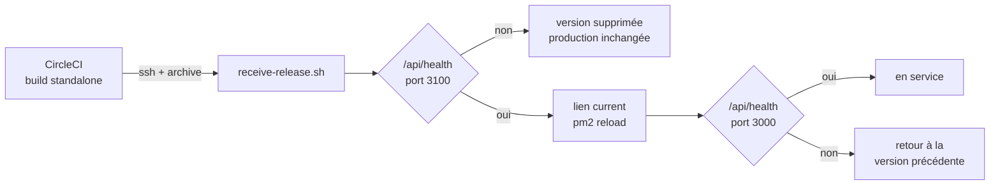

# Déploiement de l'API sur le VPS

## Principe

Sur `main`, CircleCI rejoue les contrôles (lint, types, tests, audit), construit l'API sous Node.js 24.13.0, la
version du VPS, puis synchronise le schéma MongoDB (`prisma db push`) et envoie l'archive au serveur par SSH.
L'archive contient la sortie `standalone` de Next.js : le serveur Node et les seules dépendances qu'il utilise.
Le VPS ne compile ni n'installe rien, et la version en service tourne jusqu'à la bascule.

La clé SSH de CircleCI ne peut lancer qu'une commande sur le serveur, `receive-release.sh`, qui :

1. refuse de continuer si moins de 2 Go sont libres ou si un autre déploiement est en cours ;
2. extrait la version dans `releases/<date>-<commit>` et la relie aux fichiers partagés (`shared/.env.local`,
   `shared/images`) ;
3. la démarre sur le port 3100 et attend que `/api/health` réponde, sans toucher à la version en service ;
4. bascule le lien `current`, recharge PM2 (`next-api`) et revérifie `/api/health` sur le port 3000 ;
5. revient à la version précédente si la nouvelle ne répond pas ;
6. ne garde que les trois dernières versions.

Codes de sortie, visibles dans le job `deploy-vps` : `0` version en service, `1` échec (la version précédente
reste ou redevient en service), `2` commande refusée, `3` version prête dans `current` mais PM2 ne la sert pas
(migration à terminer).



## Arborescence sur le serveur

```
~/hardwarehouse-api/
├── current -> releases/20261028102048-2222222bbbb   version servie par PM2
├── releases/                                       les trois dernières versions
├── shared/
│   ├── .env.local                                  secrets de production
│   └── images/                                     images envoyées depuis le back-office
└── bin/receive-release.sh                          seule commande permise à la clé de CircleCI
```

Les valeurs publiques figées dans le code au build (`NEXT_PUBLIC_API_URL`, clé publique Clerk) sont dans le job
`build-release` de `.circleci/config.yml`. Les secrets ne quittent jamais le serveur.

## Mise en place (une seule fois)

Chaque commande tient sur une ligne : à copier une par une. `<IP>` est l'adresse du VPS, pas le domaine, que
Cloudflare ne relaie pas en SSH.

### 1. Clé de déploiement (sur ton poste)

```bash
ssh-keygen -t ed25519 -N "" -C circleci-deploy -f ~/.ssh/hardwarehouse_circleci
```

Cette clé identifie CircleCI auprès du VPS : la partie privée va dans CircleCI, la partie publique dans
`authorized_keys` sur le serveur (étape 4).

Dans CircleCI, *Project Settings > SSH Keys > Additional SSH Keys* : nom d'hôte `<IP>`, clé privée
`~/.ssh/hardwarehouse_circleci`. Reporte l'empreinte affichée (`SHA256:…`) dans `.circleci/config.yml`, job
`deploy-vps`, sous `add_ssh_keys`.

### 2. Variables CircleCI

*Project Settings > Environment Variables* :

- `VPS_HOST` : `<IP>` ;
- `VPS_USER` : `hwh` ;
- `VPS_KNOWN_HOSTS` : la clé d'hôte du VPS, à ne pas confondre avec celle de l'étape 1 (ci-dessous) ;
- `VPS_PORT`, seulement si SSH n'écoute pas sur le port 22 ;
- `DATABASE_URL` doit désigner la base de production, puisque le job y lance `prisma db push`.

Les variables `VERCEL_*` ne servent plus.

**`VPS_KNOWN_HOSTS`.** C'est le sens inverse de l'étape 1 : la clé qui identifie le VPS auprès de CircleCI. Personne
ne la crée à la main, elle a été générée automatiquement à l'installation du VPS (`/etc/ssh/ssh_host_ed25519_key`).
C'est elle que ton poste t'a fait accepter lors de ta toute première connexion (*Are you sure you want to continue
connecting?*), puis qu'il revérifie à chaque connexion. CircleCI ne peut pas répondre à cette question : la variable
lui donne la réponse à l'avance, et le job refuse tout serveur qui présente une autre clé.

Sur le VPS, en remplaçant `<IP>` par la valeur exacte de `VPS_HOST` :

```bash
echo "<IP> $(cat /etc/ssh/ssh_host_ed25519_key.pub)"
```

La ligne affichée (`<IP> ssh-ed25519 AAAA… root@…`) est la valeur à copier en entier. Lue sur le disque du serveur,
dans ta session SSH habituelle, elle n'a besoin d'aucune comparaison. Si le job `deploy-vps` s'arrête sur
`Host key verification failed`, la ligne ne correspond pas au serveur désigné par `VPS_HOST`, ou le VPS a été
réinstallé (sa clé d'hôte change alors) : refais cette commande.

### 3. Dossiers et fichiers partagés (sur le VPS)

```bash
mkdir -p ~/hardwarehouse-api/releases ~/hardwarehouse-api/shared/images ~/hardwarehouse-api/bin
```
```bash
cp ~/api/.env.local ~/hardwarehouse-api/shared/.env.local
```
```bash
chmod 600 ~/hardwarehouse-api/shared/.env.local
```
```bash
cp -r ~/api/public/images/. ~/hardwarehouse-api/shared/images/
```

La dernière commande reprend les images déjà envoyées. Une erreur « No such file » signifie qu'il n'y en a pas.

`shared/.env.local` est le seul fichier de variables que lit l'API en production. Il doit contenir :

- `DATABASE_URL` : base MongoDB de production ;
- `CLERK_SECRET_KEY` : clé secrète de Clerk ;
- `INTERNAL_API_SECRET` : secret des appels du back-office à ses propres routes. Sans lui, les listes de produits,
  de marques et de remises s'arrêtent à 25 éléments. Une valeur aléatoire suffit (`openssl rand -hex 32`) ;
- `SHOP_API_TOKEN` : jeton des sorties de stock, même valeur que dans la boutique.

Contrôle, qui n'affiche que les noms des variables présentes :

```bash
grep -o -E '^(DATABASE_URL|CLERK_SECRET_KEY|INTERNAL_API_SECRET|SHOP_API_TOKEN)=' ~/hardwarehouse-api/shared/.env.local
```

Après une modification de ce fichier, `pm2 reload next-api` relance l'API, qui le relit.

### 4. Script et clé autorisée

Depuis ton poste, à la racine du dépôt :

```bash
scp deploy/receive-release.sh hwh@<IP>:hardwarehouse-api/bin/
```

Sur le VPS :

```bash
chmod 700 ~/hardwarehouse-api/bin/receive-release.sh
```

Toujours sur le VPS, crée `~/.ssh` s'il n'existe pas encore, ce qui est le cas tant qu'aucune clé n'est autorisée
pour `hwh` (nano ne crée pas les dossiers). SSH ignore un dossier ou un fichier de clés que d'autres utilisateurs
peuvent modifier, d'où les `chmod`.

```bash
mkdir -p ~/.ssh
```
```bash
chmod 700 ~/.ssh
```

Ajoute ensuite à `~/.ssh/authorized_keys` (`nano ~/.ssh/authorized_keys`) une ligne qui limite la clé à ce script
(`restrict` coupe aussi les redirections de port et le terminal), suivie du contenu de
`~/.ssh/hardwarehouse_circleci.pub` :

```
command="/home/hwh/hardwarehouse-api/bin/receive-release.sh",restrict ssh-ed25519 AAAA… circleci-deploy
```
```bash
chmod 600 ~/.ssh/authorized_keys
```

Contrôle depuis ton poste. Les options n'essaient que cette clé, sans repli sur un mot de passe : sans elles, ta propre
connexion pourrait répondre à la place de la clé de CircleCI et fausser le résultat. La première commande doit afficher
`Commande refusée : « ls »` et finir avec le code 2 (`echo $?` juste après), la seconde `Aucune version en service`.

```bash
ssh -o IdentitiesOnly=yes -o PreferredAuthentications=publickey -i ~/.ssh/hardwarehouse_circleci hwh@<IP> ls
```
```bash
ssh -o IdentitiesOnly=yes -o PreferredAuthentications=publickey -i ~/.ssh/hardwarehouse_circleci hwh@<IP> rollback
```

`Permission denied (publickey…)` signifie que la clé n'est pas acceptée : vérifie la ligne et les deux `chmod`. Un code
126 ou 127 signifie que le script manque ou n'est pas exécutable (`scp` et `chmod 700` du début de l'étape).

### 5. Premier déploiement, puis bascule de PM2

Lance le pipeline de `main`. Le job `deploy-vps` s'arrête volontairement avec le code 3 : la version est prête dans
`~/hardwarehouse-api/current`, mais l'ancienne installation (`~/api`, `npm start`) est toujours en service.
Bascule PM2 (coupure de quelques secondes) :

```bash
pm2 delete next-api
```
```bash
pm2 start ~/hardwarehouse-api/current/ecosystem.config.js
```
```bash
pm2 save
```

Vérifie, puis relance le job `deploy-vps`, qui doit finir en vert :

```bash
curl -s http://127.0.0.1:3000/api/health
```
```bash
pm2 info next-api | grep -e cwd -e path
```

La réponse attendue est `{"status":"ok"}`, et `exec cwd` doit valoir `/home/hwh/hardwarehouse-api/current`.

Pour revenir à l'ancienne installation en cas de problème : `pm2 delete next-api`, puis
`cd ~/api && pm2 start npm --name next-api -- start -- -p 3000`, puis `pm2 save`. Une fois les déploiements
validés, `~/api` peut être supprimé (plus de 1 Go).

## Opérations courantes

- **Retour à la version précédente** : la seconde commande de contrôle de l'étape 4 (`… hwh@<IP> rollback`), ou sur
  le VPS `~/hardwarehouse-api/bin/receive-release.sh rollback`.
- **Journaux** : `pm2 logs next-api`.
- **Modifier `receive-release.sh`** : recopie-le avec `scp` (étape 4). La CI ne le met jamais à jour elle-même : la
  clé qu'elle utilise ne peut pas réécrire la commande qu'elle a le droit de lancer.
- **Modifier `ecosystem.config.js`** : `pm2 reload` ne relit pas ce fichier. Après le déploiement, `pm2 delete
  next-api`, `pm2 start ~/hardwarehouse-api/current/ecosystem.config.js`, puis `pm2 save`.

## Images du catalogue

Le serveur `standalone` de Next.js ne sert que les fichiers de `public/` présents à son démarrage : une image envoyée
depuis le back-office resterait introuvable (404) jusqu'au déploiement suivant. Nginx sert donc lui-même `/images/`,
directement depuis `shared/images`. Dans le bloc `server` de `api.hardwarehouse.fr`, à côté de `location /` (`^~`
écarte les `location` à expression régulière, qui l'emporteraient sinon sur un simple préfixe) :

```nginx
location ^~ /images/ {
    alias /home/hwh/hardwarehouse-api/shared/images/;
    expires 1d;
    access_log off;
}
```

Un envoi depuis le back-office remplace l'image sous le même nom (`thumbnail.webp`) : l'expiration d'un jour borne le
temps pendant lequel un navigateur ou Cloudflare montre encore l'ancienne. Au-delà, le navigateur revalide, et Nginx
répond `304` si le fichier n'a pas changé.

```bash
sudo nginx -t
```
```bash
sudo systemctl reload nginx
```

Contrôle depuis ton poste, qui doit répondre `200` avec `content-type: image/webp` (remplace le slug par celui d'un
produit qui a des images) :

```bash
curl -sI https://api.hardwarehouse.fr/images/products/amd-ryzen-5-5600/thumbnail.webp
```

Un `403` signifie que Nginx (`www-data`) ne peut pas traverser les dossiers de `hwh` : `namei -l
/home/hwh/hardwarehouse-api/shared/images` montre lequel. `chmod o+x` sur ce dossier autorise la traversée sans
permettre d'en lister le contenu.

### Catalogue resserré et images officielles

Deux scripts ont préparé le catalogue en octobre 2026 : `scripts/curate-catalogue.mjs` désactive les produits absents de
`scripts/catalogue-selection.json` (15 par catégorie, rien n'est supprimé), et `scripts/import-catalogue-images.ts`
installe les images officielles listées dans `scripts/catalogue-images.json`. Les images sont générées sur un poste
(`public/images/products`), puis copiées sur le VPS. Tous deux simulent par défaut et n'écrivent qu'avec `--apply`.

L'ordre compte : la boutique doit savoir afficher un chemin relatif (filtre `catalog_image`) avant que la base de
production n'en contienne, et Nginx doit servir les fichiers avant que la base n'y renvoie.

1. Déployer la boutique qui contient le filtre `catalog_image`.
2. Ajouter le bloc Nginx ci-dessus.
3. Depuis ton poste, à la racine du dépôt, une fois les images générées en local :
   ```bash
   rsync -av public/images/products/ hwh@<IP>:hardwarehouse-api/shared/images/products/
   ```
4. Toujours depuis ton poste, avec la base de production dans un fichier hors du dépôt (`chmod 600`), pour qu'aucun
   commit ne puisse l'emporter. Il ne contient que `DATABASE_URL`. Chaque commande se lance d'abord sans `--apply` :
   ```bash
   node --env-file=$HOME/.hardwarehouse/api-production.env scripts/curate-catalogue.mjs
   ```
   ```bash
   node --env-file=$HOME/.hardwarehouse/api-production.env --import tsx scripts/import-catalogue-images.ts --db-only
   ```
   `--db-only` ne télécharge rien : il reporte en base les chemins des fichiers copiés à l'étape 3, avec le MPN et
   l'EAN du manifeste.

## Tester le script

```bash
bash deploy/tests/receive-release.test.sh
```

Les tests déploient de vraies versions minimales (un serveur Node) avec un PM2 isolé dans un dossier temporaire :
le PM2 de la machine n'est pas touché. Prérequis : `node`, `pm2`, `curl`.
